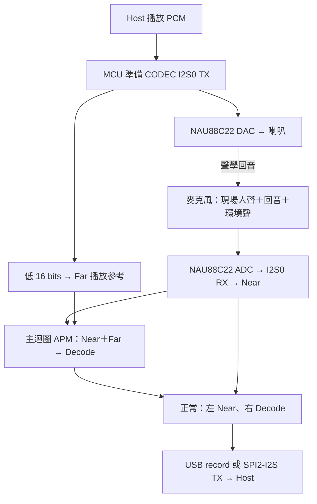

# I94124 NAU88C22 APM Demo v0.0.5

本專案提供 I94124／NAU88C22 的 USB UAC 與 I2C/I2S 音訊範例，使用相同的 Colsonic APM v0.0.5 library、參數 profile 與記憶體配置。兩種介面各自建置、分別燒錄；正常上行皆為左 Near、右 Decode。

- USB UAC：PC 經本板播放音訊，並錄回麥克風處理前／後的 stereo PCM。
- I2C/I2S：embedded host 經 I2S 收送 PCM，I2C 用於啟停、輸出選擇與 NAU88C22 控制。
- 本 repository 不包含封閉的 Colsonic `.lib` 與 `colsonicdata.bin`，建置需另備合法取得的相符檔案。
- 本範例適用 NAU88C22 板級設定；不包含 NAU88L21 板型。

## 完整流程文件

| 文件 | 內容 |
|---|---|
| **[USB 完整流程](docs/USB_UAC_FLOW.md)** | PC playback → 喇叭／Far、麥克風／Near → APM → PC record，以及 endpoint、RAM、PDMA 與串流狀態 |
| **[I2C/I2S 完整流程](docs/I2C_I2S_FLOW.md)** | Host I2S 收送、正常／bypass、RAM／PDMA，以及現有 I2C command 表與封包範例 |
| [共用啟動與音訊流程](docs/FLOW.md) | 開機、主迴圈、中斷、APM frame 交接及控制路徑 Mermaid 圖 |
| [聲道／RAM／PDMA matrix](docs/CHANNEL_MATRIX.md) | 訊號來源、buffer 容量與單位、PDMA channel／descriptor、左右聲道封裝 |
| [NS API 與調整方向](docs/COLSONIC_NS.md) | `Colsonic_ns_set()` 的現行值、增加／降低的取捨與修改位置 |
| [GoldWave 與 I2S 操作](docs/GOLDWAVE_TEST.md) | 背景播放、現場人聲、雙講與聲道觀察方法 |

## 聲道速記：正常「左前右後」，bypass「左播右收」

左／右是板子回傳給 host 的兩個觀察聲道，由應用程式封裝決定，並非 APM 規定 Near 必須放左聲道。

- **Near＝收音**：麥克風經 CODEC ADC、I2S0 RX 收到的 PCM，尚未進入 APM；可能包含現場人聲、喇叭回音與環境聲。
- **Far＝播放參考**：準備送往 CODEC DAC 的數位 PCM；新聞播報或歌曲人聲也屬於這個播放參考。
- **Decode＝處理結果**：`Colsonic_apm_proc(Near, Far, Decode)` 的輸出，目標為降低回音與雜音、保留現場語音；不是語音辨識文字或音訊檔案解碼。

| 模式 | 左聲道代表什麼 | 右聲道代表什麼 | 觀察方式 |
|---|---|---|---|
| USB 正常：Near／Decode | 處理前的麥克風混合收音 | AEC/NR 處理後的結果 | 左邊觀察人聲＋背景，右邊觀察人聲保留與背景殘留 |
| I2C/I2S 正常：Near／Decode | 處理前的麥克風混合收音 | AEC/NR 處理後的結果 | 與 USB 相同 |
| 僅 I2C/I2S bypass：Far／Near | 送往喇叭的數位播放參考 | 處理前的麥克風混合收音 | 比較播放參考與實際收音；此組沒有 Decode |

- 「前／後」指 APM 處理前／後；「播／收」指數位播放參考／麥克風收音。
- I2C 正常與 bypass 都可固定取右聲道作語音：正常取 Decode，bypass 取 Near。
- Bypass 只選擇回傳訊號，APM 仍運算；USB 不提供 bypass 入口。
- AEC 的 Near／Far 輸入角色固定；只交換回傳左右位置，不會交換演算法輸入。



## 1. 專案入口與建置

| 項目 | USB UAC | I2C 控制＋I2S 音訊 |
|---|---|---|
| 資料夾 | `SampleCode/Template/Colsonic_16k_USB_UAC` | `SampleCode/Template/Colsonic_16k_I2S_I2C` |
| Keil 專案 | [Colsonic_apm.uvprojx](SampleCode/Template/Colsonic_16k_USB_UAC/KEIL/Colsonic_apm.uvprojx) | [Colsonic_16k.uvprojx](SampleCode/Template/Colsonic_16k_I2S_I2C/KEIL/Colsonic_16k.uvprojx) |
| Target／輸出名稱 | `NAU88C22_USB_UAC_APM005` | `NAU88C22_I2S_I2C_APM005` |
| Host 音訊入口／出口 | USB EP3 OUT／EP2 IN | SPI2-I2S RX／TX |
| APM 開始條件 | Host 開啟 USB record interface | 開機自動 `Start_Audio()` |
| APM frame 觸發 | RX callback 確認 Near／Far ready 後，發布 `bDoAECReady` | 前景檢查 `bNearReady` |

建置環境為 Windows、Keil µVision 5／Arm Compiler 6.22、`Nuvoton.AudioSoCs_DFP.1.0.0` device pack，以及可建置此映像大小的 compiler license。命令列檢查另需 Python 3；文件檢查使用 Node.js。

1. 保留完整 repository 結構與兩份範例的 SDK。
2. 依[第三方組件與相依檔](THIRD_PARTY_NOTICES.md)補入兩份相同的授權 Colsonic library／profile。
3. 開啟上表 Keil target 執行 Rebuild，或在根目錄執行以下命令。

```powershell
.\BUILD.ps1 -Target All
.\BUILD.ps1 -Target USB
.\BUILD.ps1 -Target I2C
.\VERIFY.ps1 -Target All
```

- `BUILD.ps1` 預設使用 `C:\Keil_v5\UV4\UV4.exe`，可用 `-UV4` 指定 IDE 位置；建置後呼叫 `VERIFY.ps1`。
- `VERIFY.ps1` 使用 Keil `fromelf` 核對實際映像中的 NS 傳參，需可用的工具與授權環境。
- AXF／BIN／HEX 位於各 target 的 `KEIL/obj/`；map 位於 `KEIL/lst/`。這些產物不納入原始碼 repository。
- BIN 的起始位址為 `0x00000000`。燒錄時選用實際板卡與 Nu-Link probe。

## 2. 新版 library 與 NS 調整方向

| 項目 | 兩份一般專案的設定 |
|---|---|
| Library | `colsonic_apm_v0.0.5_20260213_0_0.lib`，525132 bytes |
| Library SHA-256 | `4505a89e1d13d924057dcd8c660337c7ac8bae8dd9f07bcdd10057308dc9342e` |
| Profile | `colsonicdata.bin`，728 bytes |
| Profile SHA-256 | `ec533a82819a0940c44b879bd0a16485a5d4699065f9781f192600dad2b62af6` |
| APM memory pool | `85 * 1024 = 87040` bytes |
| 音訊格式 | 16 kHz、16-bit PCM；APM 每次 320 mono samples／20 ms |
| NS preset | `Colsonic_ns_set(0.85f)`，於 `Colsonic_apm_init()` 後呼叫 |
| Startup stack | `0x1000`，4 KiB |

`Colsonic_ns_set(float percent)` 的調整方向限定於本專案使用的 binary 與適用條件：

| 調整 | 預期取捨 |
|---|---|
| 往 `1.0f` 增加 | 加強抑制；也可能讓現場人聲變弱、斷字或音色受損 |
| 降低數值 | 保留較多聲音與細節；背景也可能更明顯 |
| 目前 `0.85f` | 背景抑制與語音保留的折衷設定，效果依播放、增益與雙講條件而變 |

- `0.85f` 不代表「85% 降噪」，也不是固定衰減 dB；效果不能線性內插。
- 此 binary 對一般有限值接受 `0 < percent <= 1`；`0` 不是 NR off。移除呼叫也不能視為關閉 NS。
- USB 在 `Colsonic_Init()` 設定；I2C 在 `Colsonic_Init()` 及 `Stop_Audio()` 重設 APM 後設定，三處須一致。
- I2C command `0x13` 是上行輸出選擇，不會改變這個 preset。UART GUI 的模組參數也不能直接等同這支 API。
- 背景跟著人聲出現時，需同時考慮 Far 是否涵蓋播放訊號、Near／Far 時序與雙講行為；不能保證只靠此值降低背景而完全不影響人聲。

詳細範圍、回傳值與修改方式見 [NS API 與調整方向](docs/COLSONIC_NS.md)。

## 3. RAM／PDMA matrix

| 訊號／用途 | RAM buffer | 生產者 → 消費者 | 單位／容量 |
|---|---|---|---|
| 麥克風接收 | `au32I2S_Rx_Buff[2][32]` | I2S0 RX／PDMA ch0 → RX callback | 每 row 32 stereo words／128 B／2 ms |
| 喇叭播放與 Far 來源 | `au32I2S_Tx_Buff[2][32]` | TX callback → I2S0 TX／PDMA ch1 | 每 row 32 words；取低 16 bits 累積 Far |
| Near | `u16NearI2STmp[2][320]` | RX callback → `pu16Near` → APM／封裝 | 每 row 320 mono samples／20 ms |
| Far | `u16FarI2STmp[2][320]` | TX callback → `pu16Far` → APM／bypass 封裝 | 每 row 320 mono samples／20 ms |
| Decode | `u16DecodeTmp[320]` | APM → 正常右聲道封裝 | 640 B／20 ms mono |
| 已封裝上行 | `u32Decode[2][320]` | 主迴圈 → 輸出 callback | 2560 B／40 ms stereo，非直接 PDMA buffer |
| USB playback | `g_sUacPlayback.au32USB_RingBuff[240]` | EP3 → CODEC TX callback | 960 B／15 ms，count 為 word |
| USB record | `g_sUacRecord.au8USB_RingBuff[2560]` | CODEC RX callback → EP2 | 2560 B／40 ms，count 為 byte；無 USB PDMA |
| I2S Host 下行 | `au32SPI_I2S_Rx_Buff[2][32]` | SPI2 RX／PDMA ch6 → CODEC TX callback | 每 row 32 words／2 ms |
| I2S Host 上行 | `au32SPI_I2S_Tx_Buff[2][32]` | 輸出 callback → SPI2 TX／PDMA ch7 | 每 row 32 words／2 ms |

- 正常封裝：`Audio_PackStereo(Near, Decode)`；bypass：`Audio_PackStereo(Far, Near)`。
- 低 16 bits 為軟體契約的左聲道，高 16 bits 為右聲道；I2S 接收端需配合 LRCK／slot 設定。
- 10 次 32-word callback 累積一個 320-sample APM frame；buffer 容量不等於總延遲或可用處理期限。
- 完整 descriptor 位址、計數單位及數值範例見 [matrix](docs/CHANNEL_MATRIX.md)。

## 4. 操作與控制

1. USB 播放裝置與 GoldWave 錄音來源均選本板 UAC，保存 stereo 錄音；先以左右相同的播放內容建立 Far 參考。
2. 先錄背景單獨播放，再加入現場人聲；左聲道觀察混合收音，右聲道觀察處理結果。
3. I2C/I2S 使用 SPI2 音訊；MCU 為 I2S master，embedded host 配合時脈與格式。

| I2C 操作 | Write bytes | 行為 |
|---|---|---|
| Start | `12 01 01` | 開啟音訊傳輸；開機亦自動啟動 |
| Stop | `12 01 00` | 停止音訊並重設 APM，重新套用 NS `0.85f` |
| 正常輸出 | `13 01 01` | 左 Near、右 Decode |
| Bypass 輸出 | `13 01 00` | 左 Far、右 Near；APM 仍運算 |

- 主 slave address 為 7-bit `0x15`；`0x35/0x55/0x75` aliases 保留。I2C 僅傳控制，PCM 走 I2S。
- 完整 codec command 與讀取格式見 [I2C/I2S 完整流程](docs/I2C_I2S_FLOW.md)。
- UART0 的 `Main_Console_Handle()` 仍處理 binary tuning command；`printf` 共用 UART0，不能當成獨立 log port。
- 原始碼註解採英文 ASCII，避免依賴 Keil 中文碼頁；繁中說明使用 UTF-8 Markdown。

## 5. 板級與記憶體設定

| 項目 | 設定 |
|---|---|
| MCU／CODEC | I94124／NAU88C22 |
| APROM | `0x00000000–0x0007FFFF`，512 KiB |
| SRAM | `0x20000000–0x2002FFFF`，192 KiB |
| Linker | 各 target 的 `KEIL/I94124.sct`；descriptor 區段自 `0x20000100` 起，一般 RW/ZI 自 `0x20000200` 起 |
| CODEC 控制／音訊 | I2C1 PD0/PD1；I2S0 PD2–PD6 |
| I2C target 的 Host 控制／音訊 | I2C0 PD14/PD15；SPI2-I2S PA7–PA10 |
| Console | UART0 PB8/PB9，115200、8N1 |

Library、profile、header、pool 與 linker 配置需成套使用。兩份一般專案不連入獨立 AudioDiag 的 RAM 擷取或額外 PDMA 計時來源。

## 6. 操作限制

- I2C 只有單一 pending command，指向可重用 RX buffer；連續送命令沒有完整 queue／完成握手保護。
- I2C `0x12` 回報最近完成的軟體啟停狀態；byte ACK 不表示前景動作已完成，也不是 DMA 健康檢測。
- Codec 回讀取自週期 cache，約每 250 ms 更新；部分位元保留依賴 cache，不能將立即回覆視為即時硬體 readback。
- USB 以 Near／Far ready 觸發；I2C 只等 Near。兩者都沒有 frame sequence、時間戳與完整 ownership 保護。
- 前景落後時存在覆寫、遺失 ready 通知及 queue 計數競態風險；underrun 會補零。
- USB mute／volume request 只儲存與回覆欄位，未套用 active PCM 或 CODEC。
- Far 只取播放低 16 bits。不同內容的 stereo 播放，或未經本板播放的外部聲源，不保證有完整 AEC 參考。
- Near／Decode 同 index 不代表已消除演算法延遲；混合錄音的音量差不能直接當成純語音衰減或 AEC-only ERLE。

## 7. 原始碼同步與第三方組件

後續同步入口為根目錄 `github_push.bat`；目的 repository 為 `released/I94124_NAU88C22_APM_demo_v0.0.5`、`main`。預覽不 stage、commit 或 push；實際更新會列出變更並要求確認。

```bat
github_push.bat -CheckOnly
github_push.bat -Message "Update audio documentation"
```

- 原始碼範圍由忽略規則與上傳工具檢查；錄音、工程紀錄、IDE 個人狀態、compiler 輸出及 Colsonic binary 保留本機。
- 第三方來源與 binary 放置方式見 [第三方組件與相依檔](THIRD_PARTY_NOTICES.md)；本 repository 不替第三方組件另行授權。
