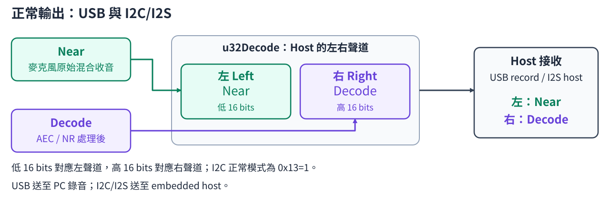

# I94124 NAU88C22 APM Demo v0.0.5

本專案提供 I94124／NAU88C22 的 USB UAC 與 I2C/I2S 音訊範例，使用相同的 Colsonic APM library、參數 profile 與記憶體配置。兩種介面的傳輸與處理觸發條件不同，正常上行均為左 Near、右 Decode。

- `v0.0.5` 對應本專案使用的 Colsonic library；版本與 SHA-256 於下表記錄。
- Repository 包含建置所需的 Colsonic library、profile、SDK 與 Keil 專案設定，交付方式與 v0.0.2a 一致。
- 兩份一般專案的 NS preset 均為 `0.85f`，startup stack 均為 4 KiB；板型為 NAU88C22。

## 完整流程文件

| 文件 | 內容 |
|---|---|
| **[USB 完整流程](docs/USB_UAC_FLOW.md)** | PC 播放 → 喇叭／Far、麥克風／Near → APM → USB 錄音，以及 endpoint／RAM／PDMA 流程 |
| **[I2C/I2S 完整流程](docs/I2C_I2S_FLOW.md)** | Host I2S 音訊、正常／bypass 模式、buffer 流程，以及完整 I2C command 表與封包範例 |

兩份文件與 README 使用 repository 相對連結；目錄結構一併上傳至 GitHub 後，可從首頁開啟完整文件及其中的 Mermaid 流程圖。

## 訊號來源與上行聲道

Far 是送往喇叭播放的數位參考；Near 是麥克風經 CODEC ADC 收到、尚未進入 APM 的混合收音；Decode 是 AEC/NR 處理後的結果。



### USB 與 I2C/I2S 正常輸出

左聲道輸出 Near，右聲道輸出 Decode。PC 錄音與 embedded I2S host 均依此順序接收。



### I2C/I2S bypass 輸出

I2C command `13 01 00` 選擇左 Far、右 Near；此模式只改變回傳訊號，APM 仍會運算。



- 左／右是送給 host 的兩個觀察聲道，由程式封裝決定；Near／Far 是 APM 的固定輸入角色。
- Normal 的右聲道為 Decode，bypass 的右聲道為 Near。USB 不提供可操作的 bypass 入口。
- RAM、PDMA 與 word 的位元配置列於後面的聲道及 buffer matrix；I2S 實體左右 slot 仍以 host 的 LRCK 設定為準。

## 1. 範例與專案入口

| 項目 | USB UAC 範例 | I2C 控制＋I2S 音訊範例 |
|---|---|---|
| 資料夾 | `Colsonic_16k_USB_UAC` | `Colsonic_16k_I2S_I2C` |
| 完整流程、buffer 與操作說明 | [USB 詳細文件](docs/USB_UAC_FLOW.md) | [I2C/I2S 詳細文件與 command 表](docs/I2C_I2S_FLOW.md) |
| Keil 專案 | [Colsonic_apm.uvprojx](SampleCode/Template/Colsonic_16k_USB_UAC/KEIL/Colsonic_apm.uvprojx) | [Colsonic_16k.uvprojx](SampleCode/Template/Colsonic_16k_I2S_I2C/KEIL/Colsonic_16k.uvprojx) |
| Keil target | `NAU88C22_USB_UAC_APM005` | `NAU88C22_I2S_I2C_APM005` |
| 外部使用者 | PC，例：GoldWave 錄音／背景音播放 | Embedded host：I2C 下指令、I2S 收送 PCM |
| 音訊入口 | USB playback OUT；CODEC 麥克風 ADC | Host SPI2-I2S RX；CODEC 麥克風 ADC |
| 音訊出口 | CODEC 喇叭；USB record IN | CODEC 喇叭；Host SPI2-I2S TX |
| APM 開始條件 | Host 開啟 USB record interface | 開機 `Misc()` 直接呼叫 `Start_Audio()` |
| APM frame 觸發 | Near、Far ready 後，RX handler 設 `bDoAECReady` | 前景程式只檢查 `bNearReady` |

文件依名詞與聲道 matrix、端到端流程、buffer／PDMA 表及原始碼索引組織。共用 Mermaid 流程見 [FLOW.md](docs/FLOW.md)，完整 RAM／PDMA 對照見 [CHANNEL_MATRIX.md](docs/CHANNEL_MATRIX.md)。

### 建置環境

| 項目 | 專案設定 |
|---|---|
| IDE／compiler | Keil µVision 5、Arm Compiler 6.22，以及可建置此映像大小的有效授權 |
| I2C/I2S device pack | `Nuvoton.NuVoice_ISD_DFP.1.0.20` |
| USB device pack | `Nuvoton.NuVoice_ISD_DFP.1.0.20` |
| Target device | `I94124` |

1. Clone 或下載完整 repository，保留目錄結構，包含根目錄 SDK、USB 範例自帶 SDK、各自的 `Colsonic/` 與 `KEIL/`。
2. 安裝對應 device pack，開啟上表連結的 Keil 專案與 target。
3. 執行 Rebuild；AXF／BIN／HEX 產生於各範例的 `KEIL/obj/`，由 Git 預設忽略。無需另外補入 library 或 profile。

命令列建置與檢查另需 Python 3；從根目錄執行：

```powershell
.\BUILD.ps1 -Target All
.\BUILD.ps1 -Target USB
.\BUILD.ps1 -Target I2C
.\VERIFY.ps1 -Target All
```

- `BUILD.ps1` 預設使用 `C:\Keil_v5\UV4\UV4.exe`，可用 `-UV4` 指定位置；完成後執行映像檢查。
- Keil GUI Rebuild 不依賴 GitHub 同步工具或本機發布紀錄。
- 原始碼註解採英文 ASCII；README 與流程文件採 UTF-8 繁中，避免依賴 Keil 中文碼頁。

## 2. 訊號與演算法名詞

| 名詞 | 本程式的實際來源／用途 | 容易誤解的地方 |
|---|---|---|
| **Near** | 麥克風經 CODEC ADC、I2S0 RX 接收後，取每個 word 的低 16 bits，尚未經 APM 處理 | 包含現場人聲、喇叭回音及環境雜音；不是只有人聲 |
| **Far** | 準備送往 CODEC 的 I2S0 TX buffer，取低 16 bits，作為播放參考 | 是數位播放訊號；不是另一顆麥克風，也不是喇叭實際聲壓量測 |
| **Decode** | `Colsonic_apm_proc(Near, Far, Decode)` 的處理後 PCM 輸出 | 不是 MP3 解碼、語音文字或語音辨識結果 |
| **AEC** | 以 Far 為參考，處理 Near 裡與播放訊號相關的回音 | 若播放聲沒有經過此板的播放路徑，Far 可能沒有該背景音 |
| **NR／NS** | Library 內的噪音抑制處理 | 現有 I2C command 沒有獨立的 NR 開關；`0x13` 是輸出選擇，見 I2C 文件 |

APM 為封閉的 `.lib`：

- 應用層可確認輸入、輸出與呼叫條件。
- 內部雙講偵測、抑制強度及各模組行為，需依 library 定義及實際量測確認。

訊號處理關係與上行聲道配置見前方[水平方塊圖](#訊號來源與上行聲道)。

## 3. 聲道 matrix：上行觀察聲道配置

- 一個 `uint32_t` stereo word 包含兩個 16-bit PCM sample。
- 下表依程式封裝、I2S `EVENLOW` 與 USB little-endian 順序，稱低 16 bits 為左、高 16 bits 為右。
- I2S host 的左右位置以實際 LRCK／slot 設定為準。

| 模式 | 左／word 低 16 bits | 右／word 高 16 bits | `u32Decode` 的封裝公式 | 最後輸出 buffer |
|---|---|---|---|---|
| USB 正常，預設 | **Near：處理前麥克風** | **Decode：處理後** | `(Decode << 16) \| Near` | USB record `au8USB_RingBuff` → EP2 |
| I2C/I2S 正常，`0x13=1`，預設 | **Near：處理前麥克風** | **Decode：處理後** | `(Decode << 16) \| Near` | `au32SPI_I2S_Tx_Buff` → SPI2 TX |
| I2C/I2S bypass，`0x13=0` | **Far：數位播放參考** | **Near：處理前麥克風** | `(Near << 16) \| Far` | `au32SPI_I2S_Tx_Buff` → SPI2 TX |

- 新版 USB 沒有 bypass 分支或操作入口；bypass 功能由 I2C/I2S 範例提供。
- I2C bypass 在 APM 呼叫之後選擇上行訊號，APM 仍會執行。

- GoldWave 的 USB 正常錄音：**左邊為原始麥克風，右邊為處理後結果**。
- Near 包含人聲及背景；Decode 仍可能有殘餘背景，Far 則另有其數位播放來源。
- 左右聲道由 `Colsonic_Work_Handle()` 將兩個 mono 訊號封裝成 stereo word 時決定；APM 本身沒有指定 Near 或 Decode 必須放左聲道。
- APM 的輸入角色固定為 `Near`（麥克風）與 `Far`（播放參考）；交換上行左右位置不會交換這兩個演算法輸入。
- 目前聲道配置與 v0.0.2a repository 的對齊版本一致；更早的原始 I2C 左 Decode／右 Near 接收端，需改取右聲道處理結果。
- I2C bypass 也與新版 APM v0.0.5 相同：左 Far、右 Near；原始範例為左 Near、右 Far。
- I2C 右聲道在正常模式為處理後的 Decode，在 bypass 為處理前的 Near，適合 host 固定以右聲道接收語音。

## 4. RAM／PDMA buffer matrix

- 傳輸格式：16 kHz、16-bit、stereo；APM 的 Near／Far／Decode 各為 mono。
- 表內大小：各 buffer 的容量，整體 firmware RAM 另含其他資料與 stack。
- 儲存位置：一般成員在 `g_sDataManager`，USB ring 在 `g_sUacPlayback`／`g_sUacRecord`。

| Buffer／指標 | 大小與單位 | 誰寫入 → 誰讀取 | 角色 |
|---|---|---|---|
| `au32I2S_Rx_Buff[2][32]` | 共 256 B；每列 32 words＝128 B＝2 ms | I2S0 RX PDMA → RX IRQ handler | CODEC 麥克風原始 stereo 接收 |
| `au32I2S_Tx_Buff[2][32]` | 共 256 B；每列 2 ms | TX IRQ handler → I2S0 TX PDMA | 喇叭播放資料；低 16 bits 另供 Far |
| `u16NearI2STmp[2][320]` | 共 1280 B；每列 640 B＝20 ms mono | RX handler → APM／封裝 | 每次累積 32 點，10 次成一列 |
| `u16FarI2STmp[2][320]` | 共 1280 B；每列 640 B＝20 ms mono | TX handler → APM／bypass 封裝 | 從 CODEC TX 的低 16 bits 累積 |
| `pu16Near`、`pu16Far` | 指向已發布的 frame 列 | IRQ 發布指標 → 前景讀取 | 指標別名，不是另外複製的安全佇列 |
| `u16DecodeTmp[320]` | 640 B＝20 ms mono | APM → 前景封裝 | Decode 處理結果；APM 以 `int16_t *` 使用 |
| `u32Decode[2][320]` | 共 2560 B＝640 stereo words＝40 ms 容量 | 前景每次寫 320 words → IRQ 每次取 32 words | 選好左右聲道的上行 RAM 佇列；不是直接 PDMA buffer |
| I2C 的 `au32SPI_I2S_Rx_Buff[2][32]` | 共 256 B；每列 2 ms | SPI2 RX PDMA → CODEC TX handler | Host 播放下行 |
| I2C 的 `au32SPI_I2S_Tx_Buff[2][32]` | 共 256 B；每列 2 ms | SPI TX handler → SPI2 TX PDMA | Host 收音上行 |
| USB playback `au32USB_RingBuff[240]` | 960 B＝240 words＝15 ms stereo | EP3 handler → CODEC TX handler | 指標及 `u16AvalCnt` 單位為 **word** |
| USB record `au8USB_RingBuff[2560]` | 2560 B＝40 ms stereo | CODEC RX handler → EP2 handler | 指標及 `u16AvalCnt` 單位為 **byte** |

- Frame 時間：`320 / 16000 = 20 ms`；PDMA row 時間：`32 / 16000 = 2 ms`。
- **32 個 PDMA word＝128 bytes**；`u16DecodeAvalCnt` 的單位為 word。
- USB record macro 為 `80*REC_RATE*REC_CHANNELS/1000`，儲存型別為 byte；本設定是 2560 B／40 ms 容量。

## 5. CPU、IRQ、PDMA 各負責什麼？

| 執行位置 | 工作 | 資料與控制範圍 |
|---|---|---|
| PDMA 硬體 | 依 scatter-gather descriptor 交替搬移 row 0／1，連接 I2S FIFO 與 RAM | 不會自己執行 AEC／NR 或解析 I2C command |
| `PDMA_IRQHandler()` | 分派完成事件，抽出 Near／Far、填補播放與上行 buffer、更新指標及計數 | `u8...Index ^= 1` 是換列，不是把整份資料複製到另一列 |
| 前景 `Colsonic_Work_Handle()` | 達到 frame 條件時呼叫 APM，將兩個 mono 訊號封裝成 stereo `u32Decode` | `Decode` 不是 CODEC 音訊解碼器 |
| USB endpoint handler | CPU 複製 USB SRAM 與 UAC RAM ring，處理串流／feedback | USB endpoint SRAM 沒有直接交給此處的 I2S PDMA |
| I2C0 IRQ／前景 command handler | 前者收封包及回讀一個 byte，後者執行控制動作 | I2C 只傳控制，不承載本範例 PCM 音訊 |
| I2C1 codec handler | MCU 控制 NAU88C22 registers | 與 Host 下 command 的 I2C0 是不同匯流排 |
| UART0 IRQ／`Main_Console_Handle()` | 收取 binary tuning 封包、讀寫 APM 參數 | 不是單純 log port；`printf` 也使用同一 UART0 |

PDMA 每列 2 ms、APM frame 20 ms 是資料分塊大小；整體延遲另含 TX ping-pong、演算法、`u32Decode`、USB ring／host buffer，實際端到端延遲取決於這些路徑的排程與水位。

## 6. 共用的 APM library 與配套配置

- 兩份 Keil 專案各自連結相同的 `colsonic_apm_v0.0.5_20260213_0_0.lib`，並附相同的 `colsonicdata.bin`。
- Library、profile、API header 與 memory pool 成套配置，與 v0.0.2a 同樣隨 repository 提供。
- `ColsonicData_Keil.s` 以 `INCBIN` 載入 profile；只包含 `.lib` 而漏掉 `.bin` 仍無法完成建置。

| 項目 | 兩份範例的共同設定 |
|---|---|
| Library | `colsonic_apm_v0.0.5_20260213_0_0.lib`，525132 bytes |
| Library SHA-256 | `4505a89e1d13d924057dcd8c660337c7ac8bae8dd9f07bcdd10057308dc9342e` |
| Profile | `colsonicdata.bin`，728 bytes |
| Profile SHA-256 | `ec533a82819a0940c44b879bd0a16485a5d4699065f9781f192600dad2b62af6` |
| APM memory pool | `85 * 1024 = 87040` bytes |
| 音訊格式／frame | 16 kHz、PCM16；APM 每次 320 mono samples／20 ms |
| NS preset | `Colsonic_ns_set(0.85f)` |
| 共通配套 | 各 `Colsonic/` 的 header、source 與 `ColsonicData_Keil.s` |

```powershell
python -B .\scripts\check_build_delivery.py
python -B .\scripts\check_build_delivery.py --publication
```

- 交付檢查涵蓋兩份 project 的 source／include、scatter、`INCBIN`、配套 binary SHA-256 與共用 Keil options，確認必要檔案沒有被 Git 忽略。
- `VERIFY.ps1` 另核對實際映像、NS 傳參、stack 與 Flash／RAM 邊界；需要已完成的 Rebuild 與可用的 Keil 工具授權。

### NS API 與調整方向

`Colsonic_ns_set(float percent)` 在 `Colsonic_apm_init()` 後套用；USB 的 `Colsonic_Init()`、I2C 的 `Colsonic_Init()` 與 `Stop_Audio()` 重設路徑均設定 `0.85f`。

| 調整 | 本 binary 在適用條件下的取捨 |
|---|---|
| 往 `1.0f` 增加 | 加強抑制，背景可能更低；也可能讓現場人聲變弱、斷字或音色受損 |
| 降低數值 | 保留較多聲音與細節；背景殘留也可能增加 |
| 目前 `0.85f` | 背景抑制與語音保留的折衷設定，效果依播放、增益與雙講條件而變 |

- `0.85f` 不代表 85% 降噪或固定衰減 dB；效果不能線性內插。
- 此 binary 對一般有限值接受 `0 < percent <= 1`；`0` 不是 NR off，移除呼叫也不能當作關閉 NS。
- I2C `0x13` 只選擇上行訊號，未修改此 preset；UART GUI 模組參數也不能直接換算成此 API。
- 背景跟著人聲出現時，需同時考慮 Far 參考、Near／Far 配對與雙講行為；沒有只壓背景而完全不影響人聲的保證。
- 調整時三個呼叫點需一致，並同步更新 preset 檢查；詳見 [NS API](docs/COLSONIC_NS.md)。

### Keil 目標與記憶體

| 項目 | 設定 |
|---|---|
| Device | `I94124`／NAU88C22 板型 |
| SRAM／IRAM1 | `0x20000000–0x2002FFFF`，192 KiB |
| APROM／IROM1 | `0x00000000–0x0007FFFF`，512 KiB |
| Linker | 各 target 的 `KEIL/I94124.sct`，單一 Flash load region |
| Startup stack | `0x1000`，4 KiB |
| Descriptor／RW/ZI | Descriptor 固定位址自 `0x20000100` 起；一般 RW/ZI 自 `0x20000200` 起 |
| CODEC 控制／音訊 | I2C1 PD0/PD1；I2S0 PD2–PD6 |
| I2C target Host 控制／音訊 | I2C0 PD14/PD15；SPI2-I2S PA7–PA10 |
| Console | UART0 PB8/PB9，115200、8N1 |

- APM pool、其他 buffer、全域變數、heap 與 stack 共用 SRAM，實際用量以 linker map 為準。
- BIN 起始燒錄位址為 `0x00000000`；燒錄時選用實際板卡與 Nu-Link probe。
- Callgraph 無法完全界定的 stack 深度，以板上 high-water 量測確認。
- 兩份一般專案不連入獨立 AudioDiag 的 RAM 擷取或額外 PDMA 計時來源。

## 7. 操作與訊號觀察

1. 依 Keil 專案選擇範例及 target，codec、pin、clock 與 `setting.h` 應符合實際板子。
2. USB：PC 播放裝置與 GoldWave 錄音來源均選本板 UAC，錄音格式為 16 kHz／16-bit／stereo。
3. 先以背景播放觀察 Near／Decode，再加入現場人聲比較雙講行為。USB 左 Near、右 Decode。初始素材可使用 L/R 相同內容，以涵蓋 Far 只取播放低 16 bits 的路徑。
4. I2C/I2S：MCU 的 SPI2-I2S 為 **master**，host 配合時脈／格式；正常輸出為左 Near、右 Decode，bypass 為左 Far、右 Near。
5. 無聲時的資料路徑檢查順序為來源輸入、PDMA available、Near／Far ready、`u32Decode` 產出及輸出 queue 消耗。各階段函式與 underrun 行為列於完整流程文件。

### I2C 音訊啟停與回讀

| 情境 | 送出的 command bytes | 動作 | 完成後讀 `0x12` |
|---|---|---|---|
| 開機 | 無，韌體自動啟動 | `Start_Audio()` 初始化並開啟音訊 | `1` |
| 執行中 → Stop | `12 01 00` | 停止傳輸並重設 APM | `0` |
| 停止中 → Start | `12 01 01` | 重新開啟傳輸 | `1` |
| 執行中再次 Start | `12 01 01` | 維持執行，不重複啟動 | `1` |
| 停止中再次 Stop | `12 01 00` | 維持停止，不重複停止 | `0` |

- 表中回讀值為啟停動作完成後的 `0x12` 回覆。
- I2C byte ACK 表示 byte 已接收；啟停由前景程式執行。

## 8. 操作限制

- `0x12` 回報最近完成的軟體啟停狀態；I2C byte ACK 不表示啟停已完成，狀態值也不是 DMA 或 codec 的健康檢測。
- I2C 單一 pending command 指向可重用 RX buffer，沒有完整 command queue／完成握手。
- Codec 回讀為週期 cache；部分 register 更新使用 cache 的不同 byte，位元保留情形需由硬體 readback 確認。
- Near／Far 沒有 frame sequence／時間戳；I2C 也沒有同時等待 Far，時間對齊尚無保護。
- Ready 旗標及雙 buffer 沒有長時間持有的所有權保護，前景處理落後時仍可能覆寫／遺失資料。
- Underrun 會補零，overflow／遺失統計尚未完整提供；時序受輸出容量、APM 執行時間及前景 UART／I2C 工作影響。

## 9. GitHub 同步

- Repository、分支與預期可見性由 `github_repository.json` 指定。
- 後續更新從專案根目錄執行 `github_push.bat`，會列出本專案未忽略的候選變更，確認後只 stage 審閱過的路徑。
- 腳本檢查目的 repository、`main` 分支、完整建置相依檔、APM 配套、實板驗收範圍、目前檔案及提交歷史中的本機資料。
- 遠端有尚未整合的提交時會停止，保留本機工作狀態。

```bat
github_push.bat -CheckOnly
github_push.bat -Message "Update audio flow documentation"
```

- `-CheckOnly` 為唯讀預覽，不 stage、commit 或 push；更新模式要求輸入 repository 全名確認。
- 必要 `.lib`、profile `.bin`、SDK 與共用 `.uvoptx` 納入；錄音、工程紀錄、個人 `.uvguix`、diagnostics 與 compiler 產物保留本機。
- 首次更新支援已確認的空遠端；後續不自動 pull、merge 或 force push。
- 第三方 SDK 與 library 的來源及原始聲明見 [第三方組件](THIRD_PARTY_NOTICES.md)。
