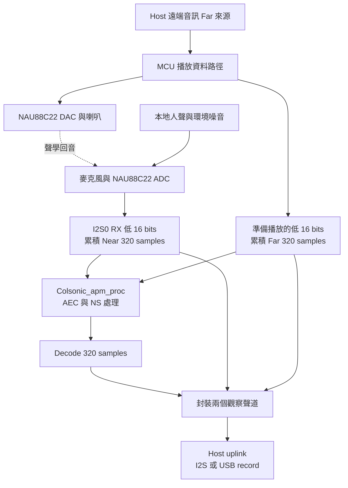
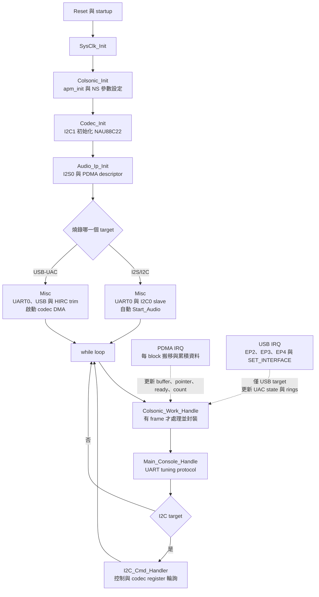
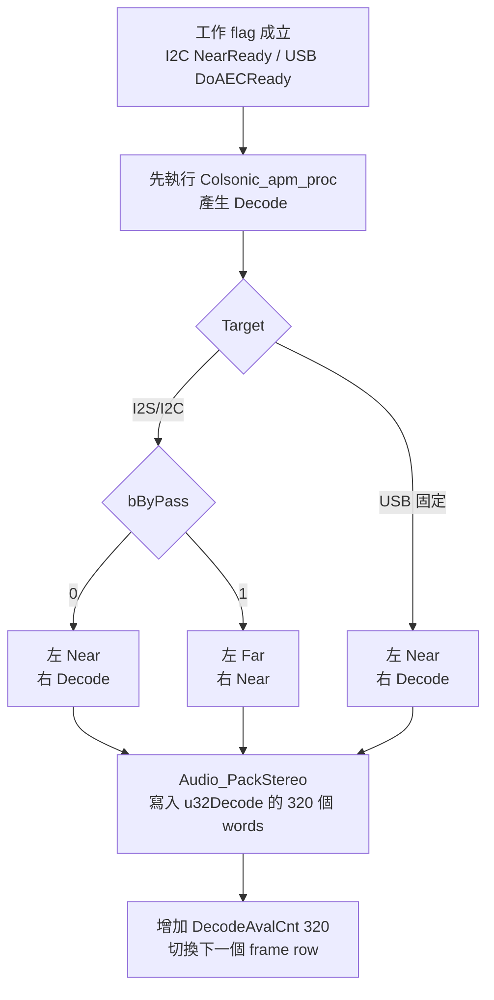
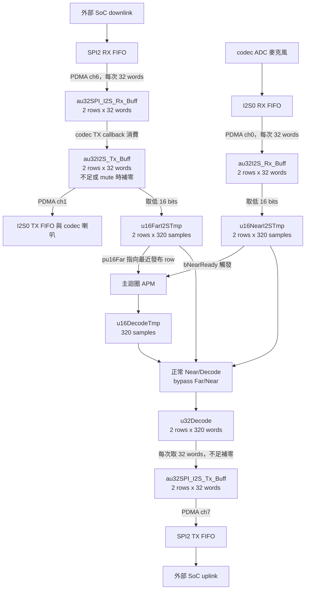
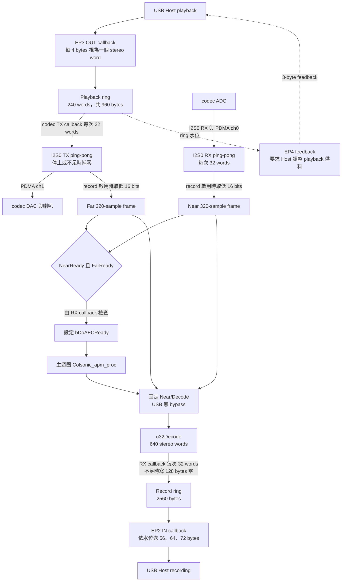
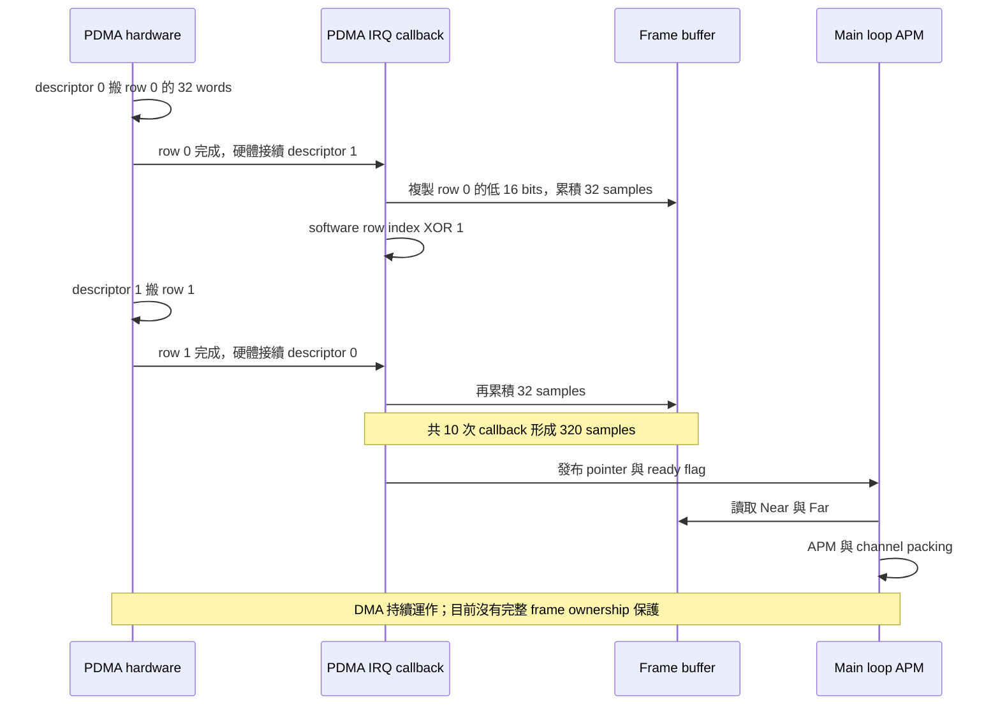
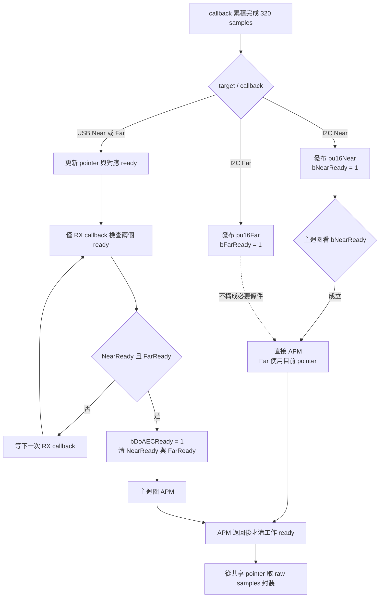
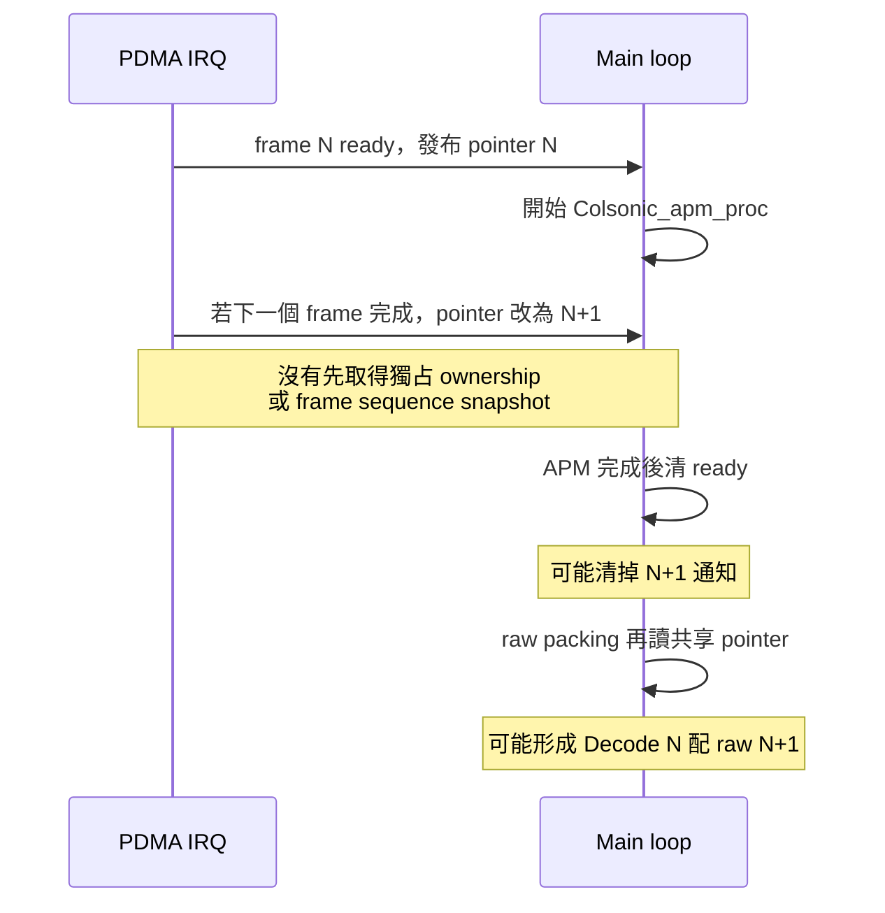
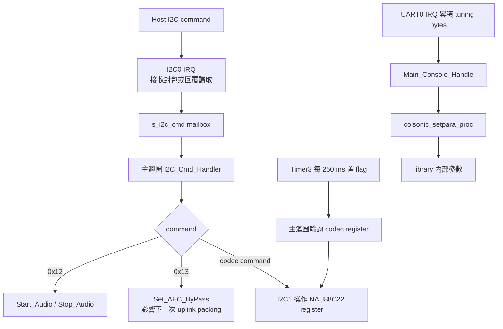

# NAU88C22 v0.0.5：從訊號到 PDMA 的完整導讀

範圍：本目錄的 Colsonic_16k_I2S_I2C 與 Colsonic_16k_USB_UAC。
以下圖表描述目前程式，兩份韌體共用的啟動、frame 與 PDMA 交接方式列於本文件。
完整介面操作見 [USB 流程](USB_UAC_FLOW.md) 與 [I2C/I2S 流程及 command](I2C_I2S_FLOW.md)，容量與聲道見 [buffer matrix](CHANNEL_MATRIX.md)。

## 1. 三個訊號與兩個 target

| 名稱 | 內容 | 不應混淆的地方 |
|---|---|---|
| Near | codec 麥克風 I2S0 RX 的低 16 bits | 包含本地人聲，也可能包含喇叭回音與噪音 |
| Far | codec I2S0 TX「準備送出」資料的低 16 bits | 是喇叭數位參考，不是另一支麥克風；仍有 DMA、DAC、聲學延遲 |
| Decode | Colsonic_apm_proc(Near, Far, Decode) 的輸出 | 名稱沿用原專案；不是 ASR 文字辨識，也不是壓縮音訊解碼器 |

I2C target 的音訊走 SPI2/I2S；I2C0 只承載控制命令。USB target 的 Host 音訊走 MCU USB-UAC。
兩個 target 是替代韌體，不是在同一個映像同時提供兩套 Host 音訊介面。

兩聲道輸出是方便對照的觀察資料，不代表兩支麥克風。Host 若只取一個聲道，必須先知道 target 的順序。

## 2. 開機、主迴圈與中斷

APM 運算在主迴圈，PDMA IRQ 負責 block 級資料交接。USB endpoint handler 位於 USB IRQ，
不是另一組 PDMA channel。兩者會共用 ring buffer 與 counter。
目前共享狀態並沒有完整的 frame ownership 協定，圖中的箭頭不代表已保證沒有競態。

## 3. 統一聲道配置

完整的模式 × RAM × PDMA matrix 見 [CHANNEL_MATRIX.md](CHANNEL_MATRIX.md)。
本文件 Ch0/Left 指低 16 bits，Ch1/Right 指高 16 bits；
I²S 實際 LRCK/word 對應仍需邏輯分析儀驗證。

| 模式 | 左聲道 | 右聲道 |
|---|---|---|
| USB 正常 | Near：麥克風處理前 | Decode：AEC/NR 處理後 |
| I²C/I²S 正常 | Near：麥克風處理前 | Decode：AEC/NR 處理後 |
| 僅 I²C/I²S bypass | Far：播放音樂參考 | Near：麥克風處理前 |

例如 Near=0x1111、Far=0x2222、Decode=0x3333：
正常 word 為 0x33331111，bypass word 為 0x11112222。
共同 helper 先將 16-bit 數值轉成 uint32_t 再 shift，保留 signed PCM bits。

- I²C 0x13 data=0 選 bypass，data=1 選正常。
- bypass 只改 uplink 選擇，仍呼叫 APM，不是獨立 NR off。
- USB 已移除 bAlgByPass 欄位／分支，不提供 bypass。
- 正常與 bypass 的右聲道都作語音，embedded host 固定取右聲道。
- Near 與 Decode 同 index 不保證聲學時間完全對齊；library delay 未知。
- 原本 I²C 的 Decode/Near、Near/Far 已改為上表；相容舊接收端時，需配合目前的上行聲道配置。

原始碼：[共同封裝 helper](../SampleCode/Template/audio_channel.h)、
[I2C misc.c](../SampleCode/Template/Colsonic_16k_I2S_I2C/Util/misc.c)、
[USB misc.c](../SampleCode/Template/Colsonic_16k_USB_UAC/Util/misc.c)，Colsonic_Work_Handle。

## 4. I2S/I2C target 的完整資料路徑

Far 從 codec TX buffer 取出，因此反映該 buffer 的補零／mute，而非無條件取 Host 原始輸入。
不過 callback 是在填「下一輪要送出」的 row，不能把 Far 與當下 DAC 已播放的聲音視為零延遲同步。

目前 APM 只看 bNearReady，沒有等待 bFarReady；bFarReady 會被設定但未用於觸發判斷。
Host RX 的 callback 只增加可用計數，沒有發布完成 row 的 identity；下游靠軟體 index 交替消費。
這兩點限制了完成 row 的辨識與 Near／Far 配對。

## 5. USB-UAC target 的完整資料路徑

USB capture 的資料先進軟體 record ring，再由 EP2 複製到 USB endpoint buffer。
不存在「u32Decode 直接由 USB PDMA 送出」這一步。
Near/Far 的配對判斷只放在 codec RX callback；若 Far 稍後才 ready，須等下一次 RX callback 才檢查。

| SET_INTERFACE 操作 | active 程式行為 |
|---|---|
| Record alt=1 | 清 record ring 索引與計數；hw_rec_start 清 AEC frame 狀態並設 bAlgEnable=1 |
| Record alt=0 | Record STOP；bAlgEnable=0 |
| Playback alt=1 | 清 playback ring；接收 EP3；callback 依 ring 供料 |
| Playback alt=0 | Playback STOP；codec TX callback 補零 |
| Mute/volume request | 目前只儲存／回覆欄位，未看到 active PCM 或 codec 套用 |

錄音啟用但沒有 playback 時，TX 的零資料仍可形成 Far，AEC 並非一定等待 USB playback 才能開始。
Record START 先由 RX callback 填 ring，到半滿 1280 bytes 才轉 BUSY，EP2 才開始送有效 payload。
這是 20 ms 的 record ring 預填；還要加上 20 ms frame、APM 與其他 buffer 的時序，不能把總延遲寫成 20 ms。

## 6. PDMA 的 ping-pong 與 320-sample frame

| 層級 | 實際單位與容量 | 16 kHz 時間意義 |
|---|---|---|
| 每一個 DMA word | 32 bits = 兩個 16-bit 聲道 | 每聲道一個 sample |
| 每個 DMA row | 32 words = 128 bytes | 2 ms |
| 每個 TX/RX ping-pong | 2 rows = 256 bytes | 共 4 ms 儲存；完成 row 要在下一次輪回前處理 |
| Near 或 Far frame buffer | 2 x 320 x 2 = 1280 bytes | 共 40 ms 儲存；完成 row 通常只剩約 20 ms 才被重用 |
| u16DecodeTmp | 320 x 2 = 640 bytes | 一個 20 ms 單聲道處理結果 |
| u32Decode | 2 x 320 x 4 = 2560 bytes | 640 stereo frames，共 40 ms queue capacity |
| USB playback ring | 240 x 4 = 960 bytes | 15 ms |
| USB record ring | 2560 bytes / 每 stereo frame 4 bytes | 40 ms，不是 80 ms |

PDMA ctl 的 TXCNT 使用「傳輸次數減一」；此處 PDMA_WIDTH_32、TXCNT=31，
表示 32 次 32-bit 傳輸，不能把旁邊舊註解 transfer byte count 當成 32 bytes。

TX callback 補的是剛用完的 row，供下一輪使用；RX callback 讀的是剛填完的 row。
初始化把 descriptor 0 作為起點，軟體 index 也從 0 起。
若 IRQ 遺失或 row phase 錯位，單純 XOR 1 無法自行重建實際完成 row。

| active channel | 方向 | descriptors 位址 | callback |
|---|---|---|---|
| ch0，兩 target | I2S0 RXFIFO → memory | 0x20000120 的雙 descriptor | pdma_i2s_rx_handler |
| ch1，兩 target | memory → I2S0 TXFIFO | 0x20000100 的雙 descriptor | pdma_i2s_tx_handler |
| ch6，僅 I2C target | SPI2 RX → memory | 0x200001A0 的雙 descriptor | pdma_spi_i2s_rx_handler |
| ch7，僅 I2C target | memory → SPI2 TX | 0x20000180 的雙 descriptor | pdma_spi_i2s_tx_handler |

每個 descriptor 16 bytes，一對共 32 bytes。其餘 SPI1/DMIC/DPWM 程式碼存在，不代表目前 setting 已啟用。
USB target 的 USB endpoint 沒有列在這張 PDMA channel 表中。

## 7. 目前的 ready 判斷與競態示意

下面是可能的失效順序，不是已量測到的實板事件：

此示意說明目前共享狀態的限制；ready 旗標並不提供 frame identity 或獨占 ownership。

## 8. 控制路徑與各檔案用途

此圖的 I2C0/Timer3 分支僅在 I2C target 啟用；UART tuning 兩份都有。
UART request parser 與 I2C mailbox 未提供完整的封包邊界／ownership 保護。

| 檔案 | 第一次閱讀時的用途 |
|---|---|
| main.c | 開機順序、polling loop |
| setting.h / Util/init_def.h | 板卡、取樣率、pin mux、active DMA channel |
| Util/init.c | peripheral clock、I2S data format、I2C/UART/USB 初始化 |
| Util/pdma_init.c | descriptor、buffer 位址、scatter chain |
| Util/irq_handler.c | PDMA flags 分派、I2C/Timer IRQ |
| Util/pdma_handler.c | 32-word callback、Far/Near 累積、queue 消費與補零 |
| Util/misc.c | APM 呼叫、ready、channel packing、start/stop |
| Util/data_handler.h / buf_def.h | shared state、row/counter 單位、容量 |
| USB Util/AudioClass.c | EP2 IN、EP3 OUT、EP4 feedback、UAC state |
| Util/i2c_handler.c / i2c_cmd.h | I2C0 command protocol 與 NAU88C22 控制 |
| Colsonic/colsonic_para_set.c | UART tuning 封包與 library parameter API |
| KEIL/I94124.sct | descriptor 固定位址、Flash/SRAM 邊界 |

相關文件：[NS API](COLSONIC_NS.md)、[原始碼同步](GITHUB.md)、[首頁](../README.md)。
