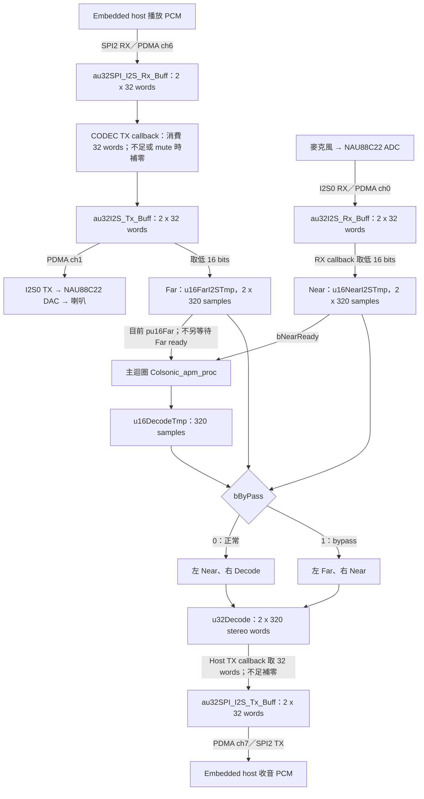
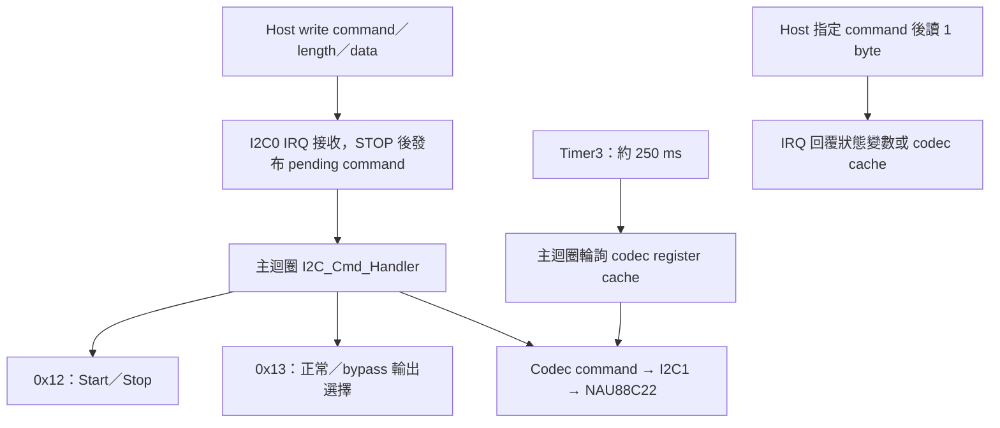

# I2C/I2S 完整流程與 command

本文件對應 `Colsonic_16k_I2S_I2C`／`NAU88C22_I2S_I2C_APM005`。PCM 走 SPI2-I2S，I2C0 只傳控制；CODEC 控制另走 I2C1。MCU 的 Host I2S 為 master，embedded host 配合 slave 時序。

## 播放、收音與輸出

1. Host 下行經 SPI2 RX PDMA 寫入 ping-pong RAM；CODEC TX callback 消費資料，填入 I2S0 TX row 播放。
2. CODEC TX row 低 16 bits 累積為 Far，因此會反映播放 refill 的補零與 speaker mute。
3. ADC 麥克風經 I2S0 RX PDMA 收入 RAM，callback 取低 16 bits 累積 Near。
4. 每 10 次 32-word callback 形成 320 samples。主迴圈只等 `bNearReady`，使用當時 `pu16Far` 執行 APM。
5. 正常封裝 Near／Decode；bypass 封裝 Far／Near。兩者都先執行 APM，再寫入 `u32Decode`。
6. Host TX callback 每次將 32 words 搬至 SPI2 TX row；PDMA ch7 再送給 embedded host。

## 開機與啟停

- `main.c` 初始化 clock、APM、CODEC、I2S0 與 SPI2-I2S／PDMA；`Misc()` 初始化 UART0、I2C0 並自動 `Start_Audio()`。
- `g_bStreaming` 開機為 START，與實際啟動一致。前景持續處理 APM、UART tuning 及 I2C command／codec cache 輪詢。
- `Stop_Audio()` 停止音訊並重新初始化 APM，再套用 NS `0.85f`；startup stack 為 4 KiB。
- `0x13` 不會略過 APM 或改 NS 值，只改輸出的兩個觀察訊號。

| 模式 | 左聲道／低 16 bits | 右聲道／高 16 bits | 最後輸出 |
|---|---|---|---|
| 正常 `13 01 01` | `pu16Near`：處理前麥克風 | `u16DecodeTmp`：AEC/NR 處理後 | `u32Decode` → `au32SPI_I2S_Tx_Buff` → SPI2 TX |
| Bypass `13 01 00` | `pu16Far`：數位播放參考 | `pu16Near`：處理前麥克風 | 同一路徑 |

右聲道在正常為 Decode、bypass 為 Near，可作固定的語音擷取 slot。完整 RAM／PDMA 對照見 [matrix](CHANNEL_MATRIX.md)。

## I2C 封包與控制流程

- 主位址為 7-bit `0x15`，aliases 為 `0x35/0x55/0x75`。使用 7-bit address 的 host API 直接傳 `0x15`，不要再左移。
- Write 格式：`[command][length][data...]`；現有控制命令使用一個 data byte。
- Read：先 write 一個 command byte 作為 register pointer，再 repeated START／read 一個 byte，最後 NACK／STOP。例如寫 `12` 後讀取啟停狀態。
- `length` 不含 command 與 length 本身。現有 parser 無完整逐命令長度檢查，正常操作使用下表的一 byte 格式。

## 現有 command 表

以下數字皆為 hex。音量欄位為 codec index／bit field，不是線性百分比。

| Command | Write data／範圍 | 動作 | Read 回覆 |
|---|---|---|---|
| `0x12` SYS | `00` Stop；`01` Start | 啟停音訊；重複同狀態不重做動作 | 最近完成的軟體狀態 `0/1` |
| `0x13` AEC_NR | `00` bypass；`01` normal | 回傳 Far／Near 或 Near／Decode，非 NR 開關 | `0/1` 模式 |
| `0x14` DAC_VOLUME | `00..FF` | 寫左右 DAC register `0x0B/0x0C`，加 update bit | 左 DAC cache 低 byte |
| `0x15` SPK_MUTE | `00` unmute；`01` mute | 更新左右 speaker register mute bit，亦影響播放資料路徑 | 軟體 mute 狀態 |
| `0x16` SPK_UP | 一個佔位 byte，例如 `00` | 依 cache 將 speaker gain index 加一，最高 `0x3F` | 無專用回讀；讀此 command 回 `0xFE` |
| `0x17` SPK_DOWN | 一個佔位 byte，例如 `00` | 依 cache 將 speaker gain index 減一，最低 `0` | 無專用回讀；讀此 command 回 `0xFE` |
| `0x18` ADC_VOLUME | `00..FF` | 寫左右 ADC register `0x0F/0x10`，加 update bit | 左 ADC cache 低 byte |
| `0x19` FW_MAJOR | 僅讀 | 讀 MCU command protocol 的 major byte | `DSP_VER_MAJOR`，目前 `0x00` |
| `0x1A` FW_MINOR | 僅讀 | 讀 MCU command protocol 的 minor byte | `DSP_VER_MINOR`，目前 `0x01` |
| `0x1B` ALC | 預設未編入 | `CODEC_ALC_FUNC` 未啟用，無 active ALC command | 預設 `0xFE` |
| `0x1C` SPKBST | `00` disable；`01` enable | 更新 output control `0x31` 的 boost bit | 軟體 boost 狀態 |
| `0x1D` PGA_GAIN | `00..3F` | 寫左右 PGA register `0x2D/0x2E` 的 gain 欄位 | 左 PGA cache `& 0x3F` |
| `0x1E` SPK_GAIN | `00..3F` | 寫左右 speaker register `0x36/0x37` 的 gain 欄位 | 左 speaker cache `& 0x3F` |

`0x19/0x1A` 不是 Colsonic library 版本。其他未知讀取回 `0xFE`；未知寫入沒有對應動作。

### 封包範例

| 用途 | Write bytes | 預期動作 |
|---|---|---|
| Stop | `12 01 00` | 完成後讀 `0x12` 得 `00` |
| Start | `12 01 01` | 完成後讀 `0x12` 得 `01` |
| 正常輸出 | `13 01 01` | 左 Near、右 Decode |
| Bypass | `13 01 00` | 左 Far、右 Near |
| Speaker mute／unmute | `15 01 01`／`15 01 00` | 關閉／恢復 speaker 路徑 |
| PGA gain index `0x10` | `1D 01 10` | 寫左右 PGA gain；硬體值以 codec readback 為準 |
| Speaker gain 加一 | `16 01 00` | data byte 為佔位，依 cache 更新 |

## 執行限制與原始碼入口

- I2C byte ACK 只代表接收；命令由前景執行。狀態改變與回傳 PCM 中的新模式到達時間不同，queue 內可能仍有舊資料。
- 單一 pending command 指向可重用 RX buffer，沒有完整 queue／完成握手；快速連發可能覆寫未處理資料。
- Codec 讀取約每 250 ms 更新 cache，立即回讀可能仍是舊值。部分 register 更新使用 cache 的不同 byte，位元保留需以實際硬體 readback 核對。
- Near／Far 沒有時間戳與 ownership；只等 Near 不保證 Far 為同一 frame。Far 來自尚待播放的 TX row，還包含 PDMA／DAC／聲學延遲。
- PDMA／queue underrun 補零；切模式沒有 frame 邊界標記。

| 原始碼 | 工作 |
|---|---|
| [main.c](../SampleCode/Template/Colsonic_16k_I2S_I2C/main.c) | 初始化與前景輪詢 |
| [misc.c](../SampleCode/Template/Colsonic_16k_I2S_I2C/Util/misc.c) | APM、聲道封裝、Start／Stop |
| [pdma_handler.c](../SampleCode/Template/Colsonic_16k_I2S_I2C/Util/pdma_handler.c) | Near／Far 累積、播放與 Host uplink |
| [pdma_init.c](../SampleCode/Template/Colsonic_16k_I2S_I2C/Util/pdma_init.c) | ch0／ch1／ch6／ch7 與 ping-pong descriptors |
| [i2c_cmd.h](../SampleCode/Template/Colsonic_16k_I2S_I2C/Util/i2c_cmd.h)、[i2c_handler.c](../SampleCode/Template/Colsonic_16k_I2S_I2C/Util/i2c_handler.c) | Command 定義、封包接收、狀態回覆與 codec 控制 |

相關文件：[共用流程](FLOW.md)、[NS API](COLSONIC_NS.md)、[I2S 操作](GOLDWAVE_TEST.md)、[首頁](../README.md)。
