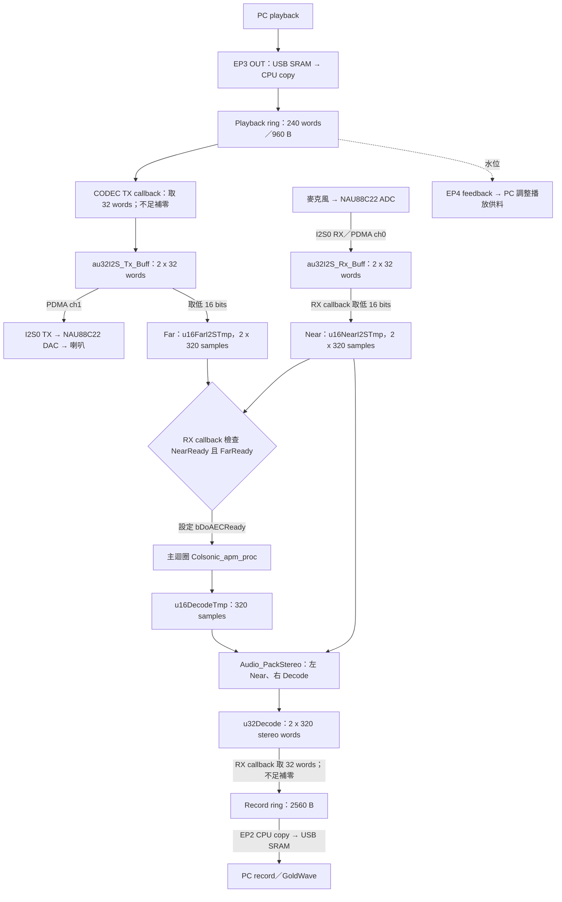

# USB UAC 完整流程

本文件對應 `Colsonic_16k_USB_UAC`／`NAU88C22_USB_UAC_APM005`，16 kHz、16-bit stereo transport。上行左 Near、右 Decode，無 bypass 入口。

## 播放、收音與輸出

1. PC 將播放 PCM 送到 EP3 OUT。Endpoint handler 以 CPU copy 填入 `g_sUacPlayback.au32USB_RingBuff`，count 使用 stereo word。
2. CODEC TX callback 每次從播放 ring 取 32 words，填入完成的 TX row，供下次 PDMA 使用；不足或停止時補零。
3. 同一 row 的低 16 bits 累積為 Far。這是「準備播放的參考」，不等同當下已到達麥克風的聲音。
4. CODEC RX PDMA 將 ADC PCM 寫入 RX row；callback 取低 16 bits 累積 Near。10 個 block 形成 320-sample／20 ms frame。
5. Record 啟用時，RX callback 檢查 Near／Far ready，發布 `bDoAECReady`；APM 在主迴圈執行，輸出 `u16DecodeTmp`。
6. 主迴圈封裝左 Near、右 Decode，寫入 `u32Decode`。RX callback 每次消耗 32 words／128 B，搬入 `g_sUacRecord.au8USB_RingBuff`。
7. EP2 IN handler 再從 record ring 複製到 USB SRAM，送給 PC。USB endpoint 路徑沒有使用這裡的 I2S PDMA。

## 啟動與串流狀態

- `main.c` 初始化 clock、APM、CODEC 與 I2S0／PDMA，再進入主迴圈。
- APM 初始化後套用 NS `0.85f`；startup stack 為 4 KiB。
- `Colsonic_Work_Handle()` 處理 ready frame；`Main_Console_Handle()` 處理 UART tuning。一般專案不連入獨立 AudioDiag。

| Host 操作 | 韌體行為 |
|---|---|
| Record alt=1 | 清 record ring；`hw_rec_start()` 重設 frame 狀態、設 `bAlgEnable=1` |
| Record alt=0 | Record STOP、`bAlgEnable=0` |
| Playback alt=1 | 清 playback ring，接收 EP3 音訊 |
| Playback alt=0 | Playback STOP，CODEC TX callback 補零 |
| UAC mute／volume request | 只儲存及回覆欄位，未套用 active PCM／CODEC |

- Record ring 先填至半滿 1280 B，約 20 ms，再由 START 進入 BUSY，EP2 開始送有效 payload。
- EP2 依水位送 56／64／72 bytes；EP4 是播放 feedback，與錄音 payload 不同。
- 沒有 playback 時，TX 的零資料仍可形成 Far，不必等待有聲播放才運作。
- 總延遲還包含 frame、APM、各 buffer 與 PC 錄音層，不能只用 20 ms 預填推算。

## 聲道與 buffer 對照

| 觀察訊號 | RAM 來源 | 輸出路徑 |
|---|---|---|
| 左 Near：處理前麥克風 | `pu16Near` → `u16NearI2STmp` 完成 row | `u32Decode` 低 16 bits → record ring → EP2 |
| 右 Decode：AEC/NR 處理後 | `u16DecodeTmp` | `u32Decode` 高 16 bits → record ring → EP2 |
| Far：播放參考 | CODEC TX row 低 16 bits → `u16FarI2STmp` | 作為 APM 第二個輸入；USB 正常錄音不直接輸出 Far |

完整容量、PDMA descriptor 與單位見 [matrix](CHANNEL_MATRIX.md)。

## 原始碼入口與限制

| 原始碼 | 工作 |
|---|---|
| [main.c](../SampleCode/Template/Colsonic_16k_USB_UAC/main.c) | 開機與前景迴圈 |
| [misc.c](../SampleCode/Template/Colsonic_16k_USB_UAC/Util/misc.c) | APM 初始化、frame 處理、上行封裝 |
| [pdma_handler.c](../SampleCode/Template/Colsonic_16k_USB_UAC/Util/pdma_handler.c) | 播放 refill、Near／Far 累積、record ring 供料 |
| [AudioClass.c](../SampleCode/Template/Colsonic_16k_USB_UAC/Util/AudioClass.c) | EP2／EP3／EP4、SET_INTERFACE 與 UAC state |
| [pdma_init.c](../SampleCode/Template/Colsonic_16k_USB_UAC/Util/pdma_init.c) | I2S PDMA ch0／ch1 descriptors |

- Near／Far ready 是旗標配對，沒有 frame sequence 或時間戳的對齊保護。
- APM 與 raw 封裝共用 IRQ 發布的 pointer；前景落後時仍有 ownership／覆寫及通知遺失風險。
- Far 只取播放低 16 bits；測試先使用左右相同的音樂，並由本板播放到喇叭。
- Near／Decode 音量差包含混合訊號與演算法延遲，不直接代表純人聲損失。

相關文件：[共用流程](FLOW.md)、[NS API](COLSONIC_NS.md)、[GoldWave 操作](GOLDWAVE_TEST.md)、[首頁](../README.md)。
